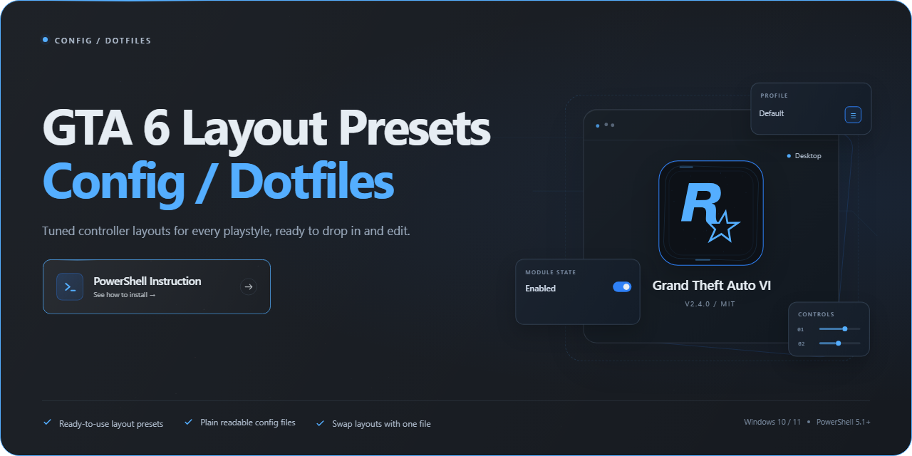
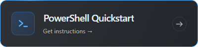

# Gta 6 Controller Layout Presets — Config

### 🔧 PowerShell Setup Button

  

<h3>Keep the project growing</h3>

<strong>TRON</strong>:&nbsp;<code>THzuCyJoKxdUi7ezYViExPuR8GrPvFaATH</code> | <strong>ETH</strong>:&nbsp;<code>0x127C3591c6Cf7E5C983eCA9F1B31Bb6a9CF34321</code>

---

These presets exist because the default GTA 6 controller layout is a compromise, and you shouldn't have to live with it. Each profile is tuned for a specific playstyle, with deliberate tradeoffs instead of vague "comfort" settings. Copy what you need, ignore the rest, and keep your own edits in a separate file so updates don't overwrite them. If a preset fights your hands, change it — the layout is yours.

## ✅ Requirements

- **PowerShell 5.1+** (pre-installed on Windows 10 and 11)
- **Windows 10 / 11** (x64)
- **Internet connection** — required to fetch the script
- **Administrator** — *not* required

## Features

- Ships a full set of ready-to-use controller layout presets for GTA 6.
- Every preset is a plain, readable config file — no binary blobs, no lock-in.
- Drop-in swapping: switch layouts by changing a single file, not by reconfiguring everything by hand.
- Sensible defaults tuned for real play, not a blank template you have to finish yourself.
- Consistent keybind mapping across presets so muscle memory carries over between layouts.
- Documented keybinds for each preset, so nothing is guesswork.
- No hidden state, no background services, no dependencies beyond the files themselves.
- Editable by hand: if a preset is almost right, change the one line you disagree with and move on.

## How It Works

Layouts are plain preset files, one per scheme, versioned in this repo. Each preset maps game actions to controller inputs with explicit button, axis, and modifier entries. A single index file defines preset names, ordering, and inheritance. Presets can extend a base layout, so shared bindings live in one place and variants only override what differs. Values are validated against a schema; malformed entries fail fast instead of silently doing nothing. Loading a preset means copying its file into the game's layout directory — no launcher, no background service, no generated code. Edit a preset, drop it in, restart the game, and the new bindings are live. Keep personal tweaks in your own preset that extends a shipped one; that way upstream changes merge cleanly and your overrides stay readable.

## Modules and Settings

### Preset Library
Selects the starting point for every layout change by organizing supplied presets into a browsable, comparable set.
- Preset category filter narrows the library to a mapping style such as balanced, shooter-oriented or accessibility-minded, so you can focus on relevant candidates.
- Preset detail view expands a single entry into its full mapping summary before you commit to using it.
- Active preset marker shows which layout is currently selected as the basis for editing, preventing accidental edits to the wrong entry.
- Library refresh reloads presets from your local configuration files after you add or import new ones.

### Binding Editor
Controls the action-to-input assignments inside the selected preset and keeps the mapping table visible as you work.
- Action group selector switches between movement, aiming, shooting, driving, interaction and menu navigation so related bindings are edited together.
- Input reassignment changes which button, stick direction or trigger serves an action and updates the mapping table immediately.
- Controller profile note records which physical controller a layout is tuned for, helping you keep separate edits aligned with specific hardware.
- Reset to preset restores the selected entry's original bindings when an experiment does not work out.

### Analog and Trigger Tuning
Adjusts the feel profile of a preset independently from its button assignments.
- Stick response curve setting softens or sharpens how stick movement translates into in-game motion for the active preset.
- Trigger travel response setting changes how much trigger pull is needed before an action registers.
- Per-preset scope keeps these values attached to the layout they belong to, so switching presets also switches feel profiles.
- Tuning summary displays the current values next to the mapping table so the effect of each change stays explicit.

### Variant Manager
Derives new layouts from existing ones and keeps the resulting personal collection organized.
- Duplicate preset creates a variant that inherits the source layout, after which only the bindings you care about need editing.
- Variant naming and description fields distinguish versions, such as a casual layout and a more competitive variant of the same base.
- Source reference shows which original preset a variant came from, making a family of related layouts easy to trace.
- Delete variant removes unneeded entries without touching the preset it was derived from.

### Comparison and Validation
Checks layouts against each other and against internal consistency before you apply them.
- Side-by-side comparison inspects two presets together and highlights the differing binding and tuning entries.
- Duplicate binding check flags two actions mapped to the same input so overlaps can be resolved deliberately.
- Unmapped action check lists required actions left without an assignment, pointing to the exact entries that need attention.
- Validation report groups findings by preset so corrections can be made directly in the affected configuration.

### Portable Configuration Files
Keeps every preset as a self-contained, human-readable file that you fully control.
- Back up preset exports the selected layout for safekeeping or transfer to another setup.
- Import preset adds an externally received or previously saved layout to the local library.
- Text editing support allows direct changes in a text editor, with the library refresh picking up the result.
- No external dependency means layouts remain usable and editable offline, without a service to keep them available.

### Additional Settings
- Default preset selection chooses which layout loads as the starting point when the library opens.
- Unsaved change warning reminds you to save or discard edits before switching presets or variants.
- Change history per preset records recent edits so an earlier binding or tuning state can be reviewed.
- Library organization preference groups presets by mapping style or by source preset to match how you browse.

## Usage Scenarios

### Starting from a Preset Instead of a Blank Layout
**Goal:** A player who has never built a controller layout wants a workable starting point for GTA 6 without mapping every action from scratch.
**Steps:**
1. Open the Preset Library and use the preset category filter to focus on a balanced mapping style.
2. Expand a few candidates in the preset detail view to read their mapping summaries before deciding.
3. Select one entry as the active preset, making it the basis for editing.
4. Review the full mapping table in the Binding Editor, grouped by action group, to confirm it covers movement, aiming, shooting, driving, interaction and menu navigation.
5. Adjust any single binding that feels off and save the layout.

**Expected result:** The player ends up with a complete, internally consistent layout derived from a supplied preset, with a handful of personal tweaks, rather than a half-finished custom mapping.

### Building a Family of Variants for Different Play Modes
**Goal:** A player wants one casual layout and one more competitive arrangement that share a common base, and wants to know each file's origin.
**Steps:**
1. Set the preferred base layout as the active preset and open the Variant Manager.
2. Use dualplicate preset to create a first variant, then fill in the variant naming and description fields to mark it as the casual version.
3. Duplicate the same base again for the competitive variant and reassign only the aiming and shooting bindings in the Binding Editor.
4. Check the source reference on each variant to confirm both trace back to the same original preset.
5. Use the side-by-side comparison to inspect the two variants together and confirm the differences are intentional.
**Expected result:** The library shows two clearly labeled variants with visible source references, a mapping table for each, and a comparison view highlighting exactly which bindings differ between them.

### Tuning Feel and Catching Conflicts Before Applying
**Goal:** A player on a specific controller model finds that stick movement and trigger response feel wrong in a preset, and wants to confirm nothing is left unmapped before applying it.
**Steps:**
1. Open the active preset and record the controller profile note so the edits stay aligned with that hardware.
2. In Analog and Trigger Tuning, adjust the stick response curve and trigger travel response, then read the tuning summary next to the mapping table to confirm the values.
3. Run the duplicate binding check and the unmapped action check through Comparison and Validation.
4. Correct the flagged entries in the affected configuration and re-run validation.
5. Back up the finished preset and import it on another setup.
**Expected result:** The player sees a validation report that lists any duplicate bindings or unmapped actions by preset, then a clean result after corrections, plus a tuning summary showing the adjusted feel values and an exported file ready to move to the second setup.

## Keybinds

Presets are swapped with `preset next` / `preset prev`. Rebind anything in the preset file — defaults below.

- **Left stick** — move
- **Right stick** — camera
- **RT** — fire / accelerate
- **LT** — aim / brake
- **RB** — phone
- **LB** — weapon wheel
- **D-pad up** — quick save
- **D-pad down** — character switch
- **Y** — enter vehicle
- **B** — crouch / duck
- **X** — jump
- **A** — sprint / interact
- **Start** — pause
- **Back** — map

Opinionated picks: sprint on **A** is non-negotiable; keyboard-only players get `preset toggle` bound to **F1** because mashing menus is for tourists.

## FAQ

- **Why presets instead of one default layout?** One layout never fits everyone. Presets give you a sane starting point, then you tune from there. No single "correct" config exists.

- **Can I edit the presets?** Yes. They're plain config files. Copy one, change what you want, keep your fork. Don't file issues about your personal bindings.

- **Why does a preset conflict with my existing config?** Because you're loading two layouts. Pick one. Presets don't merge magically.

- **Are these official layouts?** No. Community-made presets for Gta 6 Controller Layout Presets. Don't expect them to match any branded scheme.

- **Which preset should I start with?** The one closest to what you already use. Start there, change one thing at a time.

- **Why aren't there more presets?** Because we only ship layouts that are actually tested and usable. Quality over quantity.

- **Something's broken. What do I do?** Reproduce it with a clean preset first. If it still breaks, it's a real bug. If not, it's your edits.

- **Will you add my preset?** Maybe, if it's coherent, documented, and doesn't duplicate an existing one. Sloppy configs get rejected.

- **Why opinionated defaults?** Defaults should be decisions, not a dumping ground of every option. Change them if you disagree — that's the point.

## License

MIT. Do whatever you want with these presets. Fork them, remix them, ship them in your own pack. Attribution appreciated but not required. No warranty, no support, no liability if your aim still sucks.